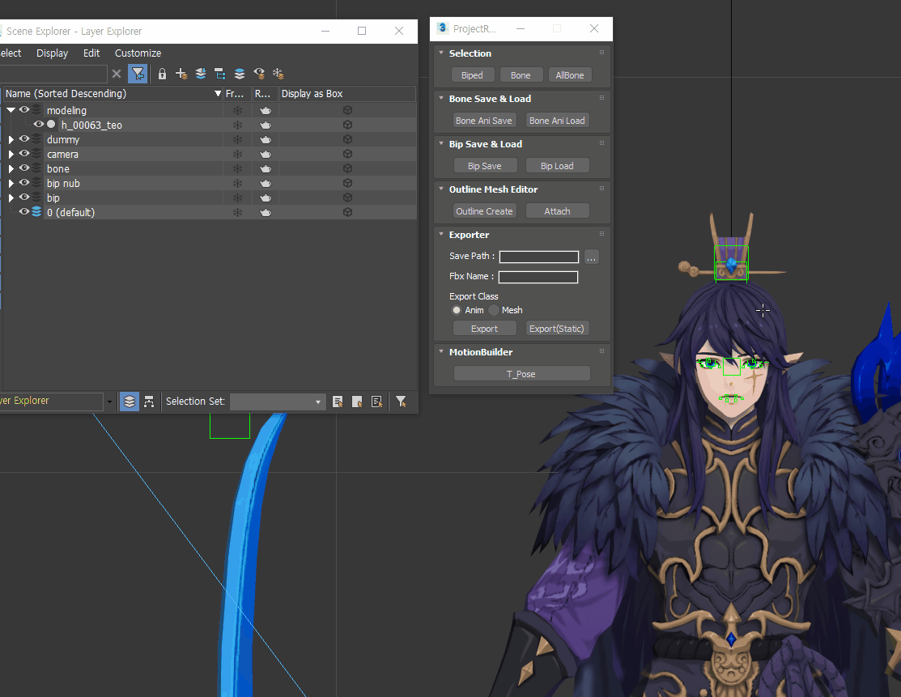
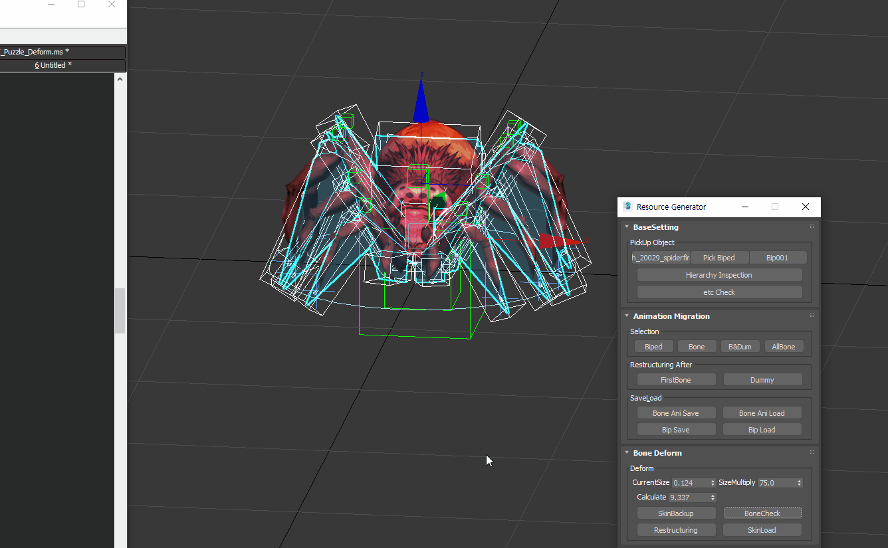

# 3ds Max Workflow Automation

**게임 제작 파이프라인의 반복 작업을 개선하기 위한 MaxScript 기반 자동화 도구 개발**

캐릭터 제작 및 애니메이션 작업 과정에서 발생하는 기술적 제약과 반복적인 수작업을 해결하기 위해 개발한 자동화 도구입니다.

3ds Max 환경에서 사용자가 직접 조작할 수 있는 UI 형태로 구현했으며, 게임 개발 프로젝트의 제작 파이프라인에 적용하여 애니메이터들이 공용으로 사용했습니다.

## Project Overview

| 구분 | 내용 |
|---|---|
| 개발 시기 | 2022년 |
| 개발 기간 | 도구별 약 2주 |
| 실무 사용 기간 | 도구별 약 8개월 |
| 개발 언어 | MaxScript |
| 개발 환경 | Autodesk 3ds Max |
| 담당 역할 | 자동화 로직 설계, UI 개발 및 구현 |
| 적용 환경 | 게임 캐릭터 제작 및 애니메이션 파이프라인 |
| 사용 대상 | 프로젝트 소속 애니메이터 전원 |

---

## 01. Face Normal Correction

### 카툰 렌더링을 위한 얼굴 노멀 방향 보정 자동화

#### Background

카툰 렌더링은 표면의 노멀 방향에 따라 명암을 단계적으로 표현하기 때문에, 얼굴의 코와 눈 주변처럼 굴곡이 복잡한 영역에서 의도하지 않은 그림자 경계가 발생할 수 있습니다.

이를 방지하기 위해 프로젝트에서 사용하는 셰이더 특성에 맞춰 얼굴 노멀의 방향을 보정해야 했습니다.

기존에는 모델러가 얼굴 영역의 노멀을 일일이 선택하고 수정해야 했으며, 캐릭터마다 동일한 작업을 반복하는 데 상당한 시간이 소요됐습니다.

#### Implementation

MaxScript를 활용하여 얼굴 노멀의 Z축 방향을 프로젝트에서 요구하는 외측 기준으로 보정하는 자동화 도구를 개발했습니다.

- 수작업으로 진행하던 노멀 방향 보정 과정 자동화
- 프로젝트 셰이딩 기준에 맞는 노멀 방향 적용
- 캐릭터별 반복 작업을 줄이고 일관된 결과를 얻을 수 있도록 개선

#### Demo

#### Result

반복적인 노멀 수정 작업을 자동화하여 모델러의 작업 부담을 줄이고, 캐릭터 간 셰이딩 품질을 일관되게 유지할 수 있도록 제작 과정을 개선했습니다.

---

## 02. Skinned Character Bone Resizing

### 스킨 작업이 완료된 캐릭터의 본 크기 조절 자동화

#### Background

게임 개발에서는 제작 비용과 시간을 줄이기 위해 기존 프로젝트에서 사용했던 캐릭터나 몬스터 리소스를 재활용하는 경우가 많습니다.

그러나 기존 캐릭터를 새로운 프로젝트에 맞게 수정할 때, 이미 스킨 작업이 완료된 캐릭터의 본(Bone) 크기를 변경하는 것은 번거로운 작업입니다.

스킨은 캐릭터의 메시가 뼈대 움직임에 따라 변형되도록 연결하는 작업으로, 본 구조나 크기 변경 시 메시 변형 및 기존 설정과의 불일치가 발생할 수 있습니다.

특히 다수의 캐릭터를 재활용해야 하는 환경에서는 이러한 수정 작업이 반복되어 제작 효율을 떨어뜨리는 원인이 됐습니다.

#### Implementation

기존 스킨 작업이 완료된 캐릭터의 본 크기 조절 과정을 간소화하는 MaxScript 기반 UI 도구를 개발했습니다.

- 스킨이 적용된 캐릭터의 본 크기 조절 작업 지원
- 복잡한 수작업을 UI 기반 작업으로 간소화
- 기존 캐릭터 및 몬스터 리소스의 재활용 과정 개선
- 애니메이터의 반복적인 리깅 관련 작업 부담 완화

#### Demo

#### Result

기존 캐릭터 리소스를 새로운 프로젝트의 제작 규격에 맞춰 수정하는 과정을 간소화했습니다. 이를 통해 애니메이터가 반복적인 본 크기 조절 작업에 소요하는 부담을 줄이고, 기존 리소스를 보다 효율적으로 활용할 수 있도록 개선했습니다.

---

## Repository Information

개발 당시 기록한 시연 GIF를 중심으로 주요 기능과 구현 목적을 정리했습니다.

원본 소스코드는 현재 보유하고 있지 않아 포함하지 않았습니다.
